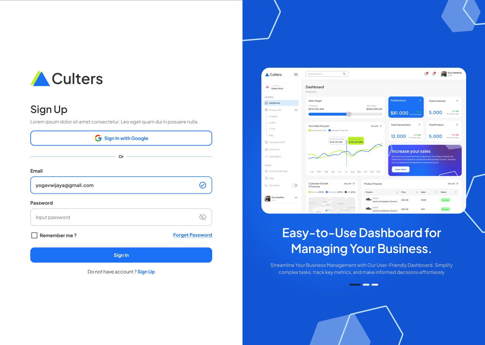
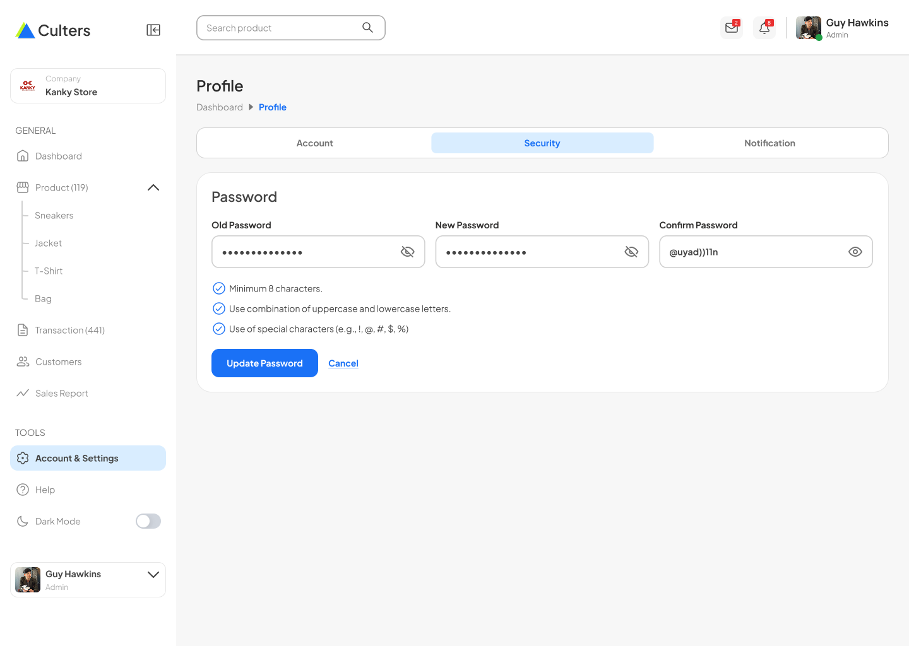
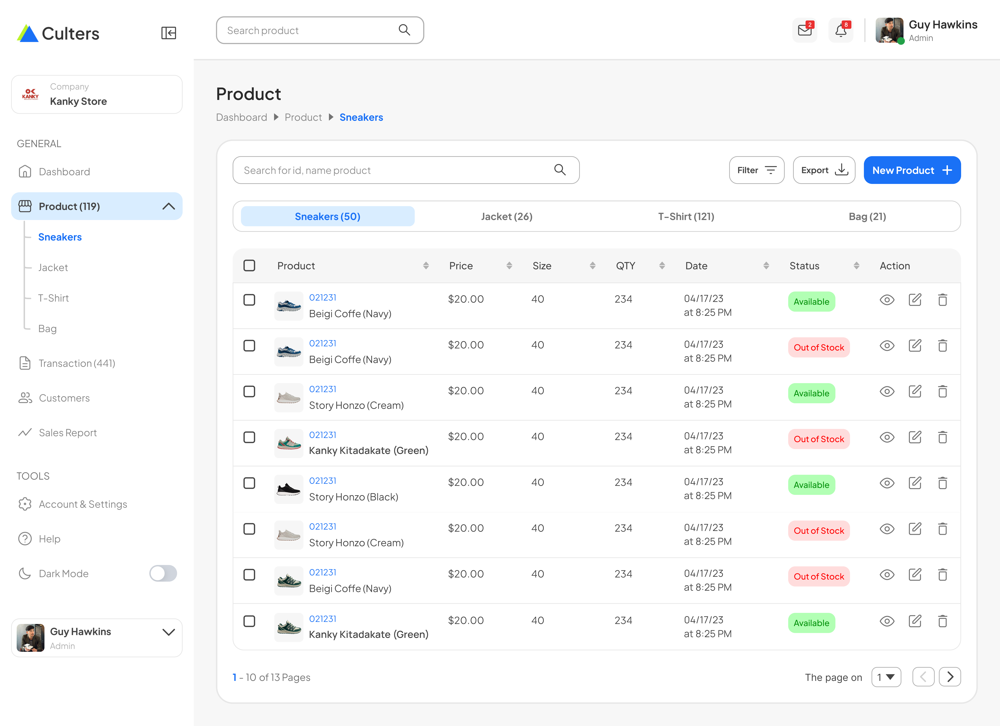
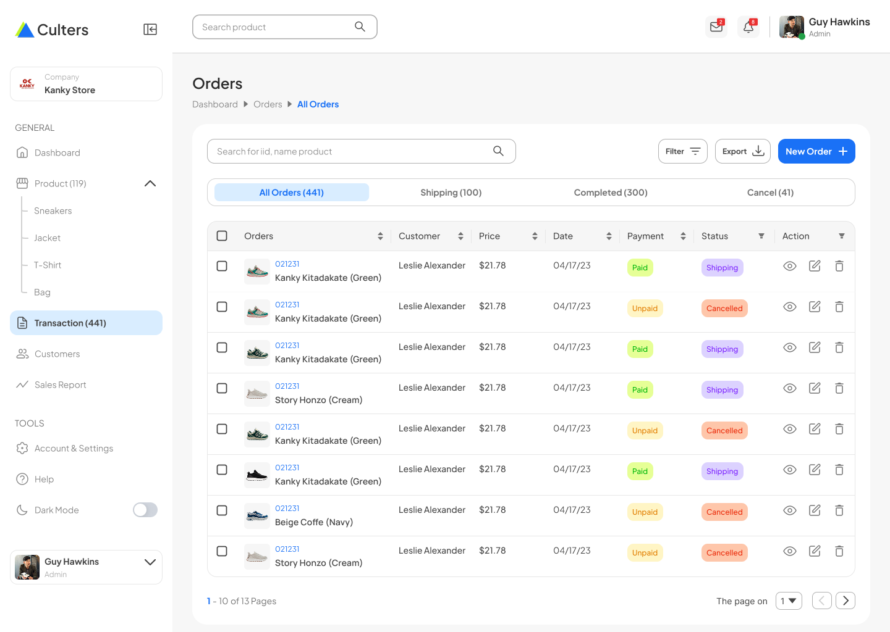
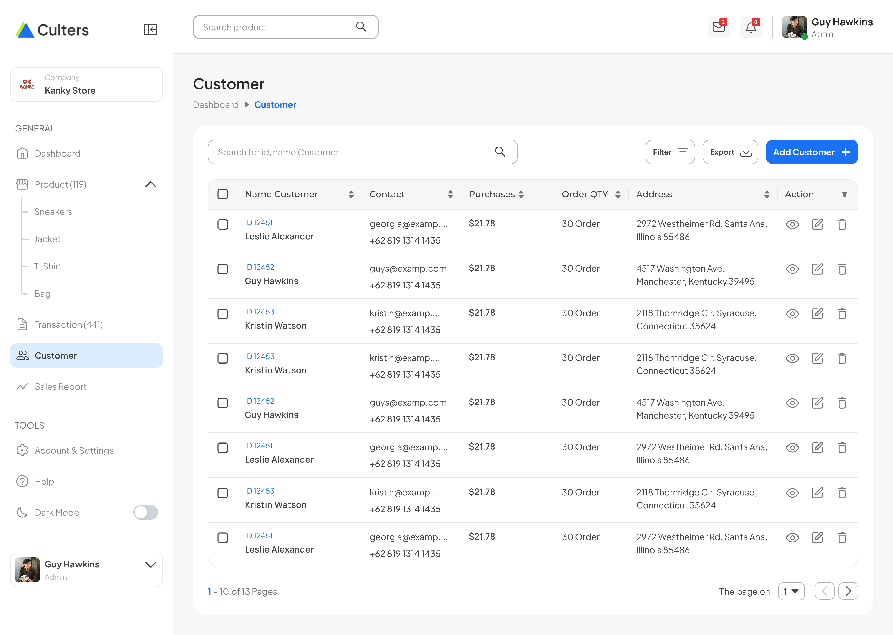

<div align="center">

  # 🚀 Culters - Commercial E-Commerce Dashboard Showcase
  
  *A polished, modern, and cross-platform E-Commerce Management Dashboard crafted to demonstrate advanced UI/UX design fidelity, clean code architecture, and multi-device responsiveness.*

  [](https://flutter.dev)
  [](https://dart.dev)
  [](https://supabase.com)
  [](https://blog.cleancoder.com/uncle-bob/2012/08/13/the-clean-architecture.html)

  <br>

  [Project Overview](#-project-overview) •
  [Key Highlights](#-key-highlights--skills-demonstrated) •
  [Architecture & Design](#-architecture--code-quality) •
  [UI Showcase & Modules](#-ui-showcase--modules)

</div>

---

## 📌 Project Overview

**Culters Dashboard** is a commercial-grade sales and inventory management platform designed from Figma to code. Built with **Flutter** and **Supabase**, this project serves as a showcase of engineering capabilities in creating highly scalable enterprise dashboards, handling complex dynamic layouts across Desktop and Mobile viewports, and maintaining pixel-perfect fidelity between UI design systems and production code.

---

## 🌟 Key Highlights & Skills Demonstrated

*   **📐 Figma-to-Code Precision:** 100% accurate translation of Figma UI/UX components, maintaining design tokens, shadows, drop-blur effects, custom color palettes, and typographic scale.
*   **📱 Multi-Platform & Responsive Engine:** Native layout adaptation using desktop sidebar layouts and mobile-first drawer/tab navigation systems.
*   **🌓 Dual Theme System:** Dynamic runtime switching between Light and Dark themes with full color-palette mapping.
*   **📊 Commercial Features & Workflows:** End-to-end administration workflows including inventory tracking, order status updates, and customer data management.
*   **⚡ Modern State Management & Architecture:** Clean separation of business logic, state propagation, and persistent backend integration with Supabase.

---

## 🏗️ Architecture & Code Quality

The application is engineered using **Clean Architecture** principles to ensure maintainability, testability, and decoupled feature modules.

```text
lib/
 ┣ 📂 core/          # Shared themes, custom UI components, extensions, and constants
 ┣ 📂 features/      # Feature-first modular structure
 ┃ ┣ 📂 authentication/  # Login, Sign Up, and Auth state logic
 ┃ ┣ 📂 dashboard/       # Sales overview, metrics charts, dynamic cards
 ┃ ┣ 📂 products/        # Inventory grid, product creation/edit forms, SKU management
 ┃ ┣ 📂 orders/          # Sales orders list, status badges, order breakdown
 ┃ ┗ 📂 customers/       # Customer profiles, purchase metrics, client details
 ┗ 📂 main.dart      # Application entry point & configuration setup

```

---
## 🖼️ UI Showcase & Modules

The dashboard is fully responsive and supports dynamic switching between **Light** and **Dark** modes, ensuring a seamless user experience across Desktop and Mobile viewports.

---

### 1. Dashboard Home & Analytics
The central hub providing real-time sales metrics, performance charts, and high-level business insights.

| Light Mode | Dark Mode |
| :---: | :---: |
|  |  |

---

### 2. Authentication & Security
Secure user authentication workflows and account security management settings.

| Login Screen | Personal Account & Security |
| :---: | :---: |
|  |  |

---

### 3. Product Catalog & Inventory Management
Comprehensive tools for browsing sneakers, managing product details, adding new items, and updating existing stock configurations.

| Product Catalog (Sneakers) | Add Product Form | Edit Product Form |
| :---: | :---: | :---: |
|  |  |  |

---

### 4. Orders & Customer Relationship Management (CRM)
Efficient tracking of sales orders alongside detailed directories for managing customers and adding new profiles.

| Orders Management | Customer Directory | Add Customer Form |
| :---: | :---: | :---: |
|  |  |  |


---

## 🛠️ Technical Stack

* **UI Framework:** Flutter (Web, Desktop & Mobile)
* **Backend & DB:** Supabase (PostgreSQL, Auth & Storage)
* **Design Tool:** Figma (Custom UI Component Kit)
* **Language:** Dart 3.x

---

### ✨ Let's Connect!

*If you like this project or want to collaborate, feel free to reach out.*